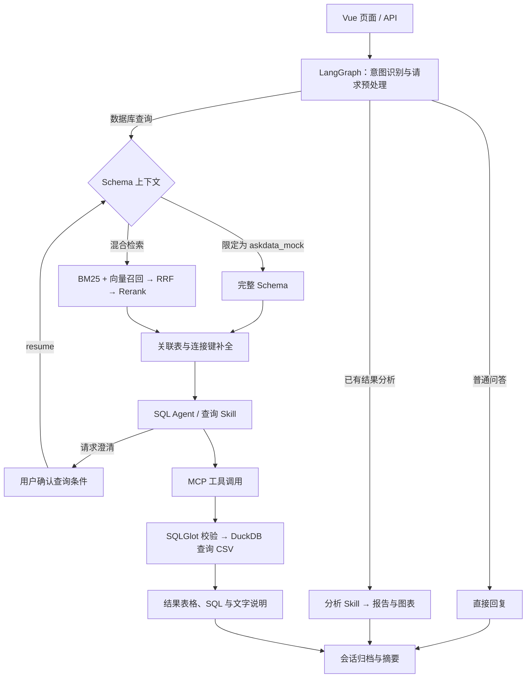

# AskData Studio：基于 LangGraph 的自然语言数据查询与分析系统

AskData Studio 面向结构化数据查询与分析场景，支持通过自然语言完成 Schema 检索、SQL 生成与校验、数据查询、结果解释和图表报告生成。项目采用 Vue 3、FastAPI 和 LangGraph，使用 CSV 与 DuckDB 提供销售及电商业务演示数据。

用户可以提交以下问题，并基于查询结果继续分析：

```text
统计2026年8月各地区的实付金额合计，按金额从高到低排序，不额外筛选订单状态。
解释各地区销售额的差异。
基于上述结果生成分析报告，附上地区对比图。
```

> 默认地址：`http://127.0.0.1:8000`  
> 接口文档：`http://127.0.0.1:8000/docs`

## 项目演示

演示视频展示数据目录、自然语言查询、SQL 查看、结果分析、交互式澄清、报告导出和已存结果复用。

[▶ 点击观看 AskData Studio 项目演示视频](Video/video.mp4)

视频文件：`Video/video.mp4`。

## 核心能力

- **自然语言问数**：解析问题中的指标、维度、筛选条件和时间范围，生成 SQL 并返回查询结果。
- **LangGraph 意图路由**：区分普通问答、数据库查询与已有结果分析，组织对应的状态流转。
- **Schema 混合检索**：结合 BM25、向量召回、RRF 融合和 Rerank 重排筛选字段，通过 BFS 补充关联表与连接键。
- **Skill 与 MCP 工具调用**：以配置定义允许的工具、输出动作和调用次数，通过 MCP 调用数据库、时间及图表工具。
- **交互式澄清**：针对需要确认的查询条件，通过 `interrupt` 暂停任务，在用户选择后通过 `resume` 恢复执行。
- **SQL 校验与权限检查**：使用 SQLGlot 解析 SQL AST，校验只读语句、物理表引用及账号的数据库与表访问权限。
- **多轮对话与会话归档**：组织近期问题和结果上下文，异步生成历史摘要，通过 SQLite 保存对话、工作区与结果快照。
- **流式展示与结果分析**：通过 SSE 展示处理进度和回答内容，支持表格分页、Excel 兼容格式导出、柱状图、饼图及 Markdown 分析报告。

## 系统架构



一次问数请求依次经过以下步骤：

1. **请求预处理**：识别意图，结合近期上下文整理独立问题与检索词。
2. **Schema 准备**：查询范围确定为 `askdata_mock` 时提供完整 Schema；混合检索路径根据字段相关性筛选上下文，并补充关联关系。
3. **工具决策**：SQL Agent 根据查询 Skill 选择 MCP 工具，生成结构化调用参数；需要确认业务条件时进入澄清流程。
4. **查询执行**：完成 SQL AST 和权限检查后，由 DuckDB 查询 CSV 数据。
5. **结果组织**：返回表格、SQL 与文字说明，保存会话；后续分析复用已有结果生成解释、图表或报告。

## 技术栈

| 层级 | 技术与作用 |
| --- | --- |
| 前端 | Vue 3、TypeScript、Vite；对话、数据目录、结果表格与图表展示 |
| 后端接口 | Python 3.11、FastAPI、Pydantic、Uvicorn；HTTP 接口、数据模型与页面服务 |
| Agent 编排 | LangGraph；意图路由、查询状态与交互式澄清 |
| 模型接入 | Chat、Embedding、Rerank API；问题理解、语义检索、SQL 生成与结果分析 |
| Schema 检索 | BM25、向量召回、RRF、Rerank；字段筛选与排序 |
| 工具调用 | MCP 进程内 Client / Server、应用 Skill；数据库、时间和图表工具 |
| 数据查询 | CSV、DuckDB；演示数据存储与 SQL 执行 |
| SQL 校验 | SQLGlot AST；语句类型、表引用与访问权限检查 |
| 会话与记忆 | SQLite、JSON、线程池；对话归档、已存资产与异步摘要 |
| 测试与评测 | unittest、固定任务集与评分脚本 |

## 内置数据

项目提供两套由固定随机种子生成的合成数据：

| 数据库 | 业务场景 | 表数 | 数据规模 |
| --- | --- | ---: | ---: |
| `askdata_mock` | 销售订单、客户、产品与销售目标 | 5 | 770 行 |
| `ecommerce_ops` | 用户、商品、交易、营销、履约及售后 | 50 | 381,963 行，392 个字段 |

销售示例数据覆盖2026年6月至8月；电商数据覆盖2025年1月至2026年8月22日。查询示例使用明确日期，便于复现与结果核对。数据生成规则及文件说明见[数据说明](backend/data/README.md)。

## 快速启动

### 1. 环境要求

- Python 3.11
- Node.js 20.x（20.19+），或22.12及以上版本
- npm
- 可用的 Chat、Embedding 和 Rerank 接口及 API Key

以下命令使用 Windows PowerShell，并从项目根目录执行。macOS / Linux 命令见[开发说明](docs/development.md)。

### 2. 安装依赖

```powershell
py -3.11 -m venv backend/.venv
backend/.venv/Scripts/python.exe -m pip install -r backend/requirements.txt
```

### 3. 配置环境变量

复制后端配置示例，保留已有配置文件：

```powershell
if (-not (Test-Path backend/.env)) { Copy-Item backend/.env.example backend/.env }
```

编辑 `backend/.env`，配置 API Key、模型名称和接口地址：

```dotenv
LLM_API_KEY=your_api_key
LLM_BASE_URL=https://dashscope.aliyuncs.com/compatible-mode/v1
LLM_MODEL=qwen-plus
EMBEDDING_MODEL=text-embedding-v4
RERANK_MODEL=qwen3-rerank
RERANK_BASE_URL=https://dashscope.aliyuncs.com/compatible-api/v1
```

三个接口共用 `LLM_API_KEY`，模型名称与地址应与所使用的服务对应。其余参数见 [backend/.env.example](backend/.env.example)。后端自动加载 `.env`，系统环境变量优先于文件配置。

### 4. 初始化数据

依次生成 CSV、构建 Schema 并校验数据：

```powershell
backend/.venv/Scripts/python.exe backend/seed_demo_data.py
backend/.venv/Scripts/python.exe backend/scripts/generate_ecommerce_data.py
backend/.venv/Scripts/python.exe backend/scripts/generate_ecommerce_schema.py
backend/.venv/Scripts/python.exe backend/scripts/validate_ecommerce_data.py
```

生成文件位于 `backend/data/databases/`。已有自定义数据时应先备份；更新 Schema 后需重启后端。

### 5. 构建页面并启动

```powershell
cd frontend
npm.cmd ci
npm.cmd run build
cd ../backend
.venv/Scripts/python.exe run.py
```

前端页面与 API 由同一服务提供。启动后访问：

- 页面：[http://127.0.0.1:8000/](http://127.0.0.1:8000/)
- 接口文档：[http://127.0.0.1:8000/docs](http://127.0.0.1:8000/docs)
- 健康检查：[http://127.0.0.1:8000/api/health](http://127.0.0.1:8000/api/health)

指定其他端口：

```powershell
.venv/Scripts/python.exe run.py --port 8001
```

### 6. 登录与查询

| 演示账号 | 密码 | 数据范围 |
| --- | --- | --- |
| `mock` | `mock123` | `askdata_mock` |
| `sales` | `sales123` | `ecommerce_ops` |
| `admin` | `admin123` | 两个演示库 |

使用 `mock` 账号登录后，新建对话并提交开头的示例问题。查询完成后可查看 SQL、导出结果，或选中结果表生成分析报告。管理员查询可在问题中指定数据库，例如「只查询 askdata_mock：统计2026年8月各地区的实付金额合计」。

## 项目结构

```text
AskData-Studio/
├── backend/
│   ├── app/
│   │   ├── api/                               # HTTP 与 SSE 接口
│   │   ├── workflows/                         # LangGraph 流程与状态
│   │   ├── querying/                          # SQL Agent、DuckDB 与结果整理
│   │   ├── retrieval/                         # Schema 检索与关联图
│   │   ├── skills/                            # 查询与分析 Skill
│   │   ├── mcp_runtime/                       # MCP Client、Server 与工具
│   │   ├── services/                          # 会话、摘要与已存资产
│   │   ├── security/                          # 账号认证与库表权限
│   │   ├── __init__.py
│   │   ├── config.py                          # 配置加载
│   │   ├── database.py                        # 表结构与关联定义
│   │   ├── demo_data.py                       # 销售示例数据生成
│   │   ├── errors.py                          # 流程异常定义
│   │   ├── main.py                            # FastAPI 应用入口
│   │   ├── model_client.py                    # 模型接口客户端
│   │   ├── models.py                          # 请求与响应模型
│   │   ├── preprocessing.py                   # 请求预处理
│   │   ├── service.py                         # 查询服务导出入口
│   │   └── streaming.py                       # SSE 消息处理
│   ├── scripts/                               # 数据生成、校验与离线验证
│   ├── tests/                                 # 自动化测试
│   ├── evaluation/                            # 评测任务、评分脚本与历史记录
│   ├── data/                                  # 数据说明与运行时数据目录
│   │   └── README.md                          # 数据生成与文件说明
│   ├── requirements.txt                       # 后端依赖
│   ├── .env.example                           # 后端配置示例
│   ├── seed_demo_data.py                      # 销售示例数据生成入口
│   └── run.py                                 # 页面与 API 启动入口
├── frontend/
│   ├── src/                                   # Vue 页面与组件
│   ├── package.json
│   ├── package-lock.json
│   ├── .env.example                           # 前端配置示例
│   ├── index.html
│   ├── tsconfig.json
│   ├── vite.config.ts
│   └── npm-local.cmd                          # npm 启动辅助脚本
├── docs/                                      # 开发说明
│   └── development.md                         # 跨平台启动、前端开发与 API 调用
├── Video/                                     # 项目演示视频
│   └── video.mp4                              # 项目演示视频
├── README.md                                  # 项目介绍与快速启动
└── .gitignore                                 # 本地配置与运行文件忽略规则
```

## 主要 API

| 方法 | 路径 | 说明 |
| --- | --- | --- |
| GET | `/api/health` | 服务状态与公开配置信息 |
| POST | `/api/auth/login` | 登录并获取访问令牌 |
| GET / POST | `/api/conversations` | 获取或创建对话 |
| GET | `/api/schema` | 获取当前账号可见的 Schema |
| GET | `/api/schema/search` | 检索相关字段 |
| POST | `/api/query` | 提交自然语言查询 |
| POST | `/api/query/stream` | 获取 SSE 进度、回答与查询结果 |
| POST | `/api/tasks/{task_id}/clarify` | 提交澄清选项并恢复任务 |
| GET | `/api/mcp/tools` | 查看当前账号可用的 MCP 工具 |

认证方式、请求示例及前端开发命令见[开发说明](docs/development.md)。

## 测试与评测

完成数据初始化后，在项目根目录运行：

```powershell
backend/.venv/Scripts/python.exe backend/scripts/verify_offline.py
```

自动化测试使用假模型，执行实际 LangGraph 工作流、MCP 工具与 DuckDB 查询，覆盖意图路由、Schema 处理、SQL 权限校验、澄清恢复、会话归档和流式响应。

固定任务集、标准 SQL、评分规则与历史评测记录见[评测说明](backend/evaluation/README.md)。源码入口与接口调用见[开发说明](docs/development.md)。

实际配置、生成数据、会话归档、日志与缓存通过 `.gitignore` 排除，仓库保留配置示例和数据生成脚本。
